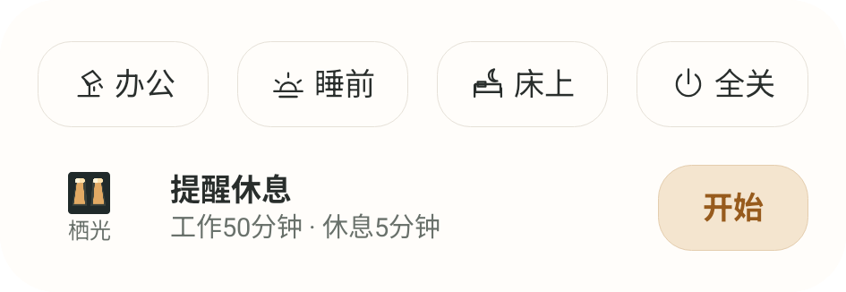
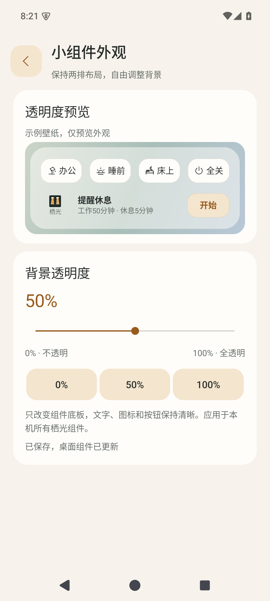

# 栖光 Qiguang

Android 本地灯控 App，把 Vont 双灯与屏幕挂灯放到一个界面和桌面组件中控制。使用原生 Java 和 Android Views，无需 Home Assistant 或额外网关。

当前公开版本 **0.8.3** 为预发布版本：已完成本地编译、策略与模拟器验收，设备地址配置调整后的实灯回归尚未完成。

## 功能

- **办公、睡前、床上、全关**：独立保存场景；床上场景支持两组灯的原生延时关灯。
- **办公提醒**：可调工作与休息时长、休息亮度和色温；开始先确认，单独结束保留当前灯光，切换场景或全关结束提醒。
- **4×2 两排组件**：四个场景入口与办公提醒；可调底板透明度，文字和按钮保持清晰。
- **Vont 精细控制**：开关、颜色、亮度、分段、两路暖光、内置效果与本地静态场景。
- **挂灯精细控制**：亮度、色温、模式和设备本地设置；保留资料与导出入口。
- 暖米白／炭灰／跟随系统外观。



## 支持范围与连接

| 设备 | 本项目实现的连接 |
| --- | --- |
| Vont TLB01，产品代码 300029 | 手机蓝牙 BLE |
| 屏幕挂灯 1S，`yeelink.light.lamp22` | 手机同一局域网，通过设备所有者的本地 Token 通信 |

这是针对上述型号的实现，不代表兼容所有 Vont、米家或 Yeelight 设备。保留原 App、米家自动化与遥控器绑定；外部自动化仍可能改变灯光。

### Vont

在设备页扫描并连接自己的 TLB01。联动优先读取本机保存的选择，兼容已有设备页选择记录；只有一个匹配设备时自动使用它。有多个匹配设备但未选择时，不猜测目标，请先进入设备页连接所需设备。

### 屏幕挂灯

已有安装继续使用手机私有目录中的加密连接配置。新配置参照 [占位模板](config/screenbar-import.example.json)，需要设备所有者合法持有的 MAC、设备 ID、局域网 IPv4 和本地 Token。本仓库不包含账号登录、Token 提取工具或任何人的连接配置。

当前导入方式适用于本机授权调试：将完整配置保存为被 Git 忽略的 `private/screenbar-import.json`，通过已授权 ADB 写入 App 私有目录的 `screenbar-import.json`，再打开挂灯页面。App 会加密保存并删除临时导入文件。不要把该文件放进共享存储、Issue 或提交记录。

公共构建只接受数值形式的私有局域网 IPv4，并核对设备回复的型号与导入配置中的 MAC。Token 仍只在手机本地用于通信。

## 组件透明度

设置与帮助 → 外观 → 小组件背景透明度。0% 为不透明，100% 为底板完全透明；拖动预览、松手保存并更新已有组件。默认 0%，保留旧外观。



实际桌面格数由启动器分配。已有组件升级后可能保留旧尺寸，可长按调整边缘；真实 vivo 桌面显示仍需实机核验。

## 构建

依赖：Python 3.10+、JDK 21、Android SDK Platform 35 和 build-tools 35.0.0。无需下载 Gradle 依赖。

设置 `JAVA_HOME` 和 `ANDROID_HOME`，或复制 `local.properties.example` 为被忽略的 `local.properties` 并填入本机路径。

```sh
python tools/build.py --unit
python tools/build.py
```

输出为 `dist/qiguang-0.8.3.apk`。默认使用本机 Android debug keystore；不存在时生成。可通过 `--keystore`、`QIGUANG_KEY_ALIAS`、`QIGUANG_KEYSTORE_PASSWORD` 指定自己的签名。密钥与本机路径不应提交。

当前 APK 保留调试能力以支持本机授权导入和验收。自行构建的签名通常与下载版本不同；覆盖安装需要相同包名与签名，不要直接卸载保存了配置的旧安装。

## 验证

```sh
python tools/build.py --unit
python tools/build.py --acceptance
python tools/verify_emulator.py --serial emulator-5680
python tools/privacy_scan.py --artifact dist/qiguang-0.8.3.apk
```

模拟器验收脚本拒绝物理手机。它使用合成设备与无效 Token，不连接真实灯具；验收工具单独构建，不包含在正式 APK 中。

办公自定义提醒由手机前台服务调度，要求局域网可达，运行时有常驻通知和有界唤醒锁。锁屏、省电和真实灯光表现仍需实机验证；强制退出或重启不会自动重放旧调光。

详细结果见 [验收记录](docs/VALIDATION.md)，隐私边界见 [隐私说明](docs/PRIVACY.md)。

## 目录

```text
app/            原生 Java、资源和 Manifest
tests/          策略测试及独立 Android 验收工具
tools/          可移植构建、模拟器验收、提交隐私扫描
config/         仅占位符配置模板
docs/           使用边界、验收记录和脱敏示意截图
```

原厂 APK、反编译产物、个人授权资料及历史实灯导出不在仓库中。

## 开发协作

项目采用“同步主线 → 任务分支 → 实现与测试 → 提 PR → 维护者确认 → 合并”的流程。每项功能先开分支，检查通过后提 PR，收到本次明确确认后才合并；当前不设置必须第二个人批准。

详见 [开发规范](CONTRIBUTING.md)；代理协作先读 [AGENTS.md](AGENTS.md)。
